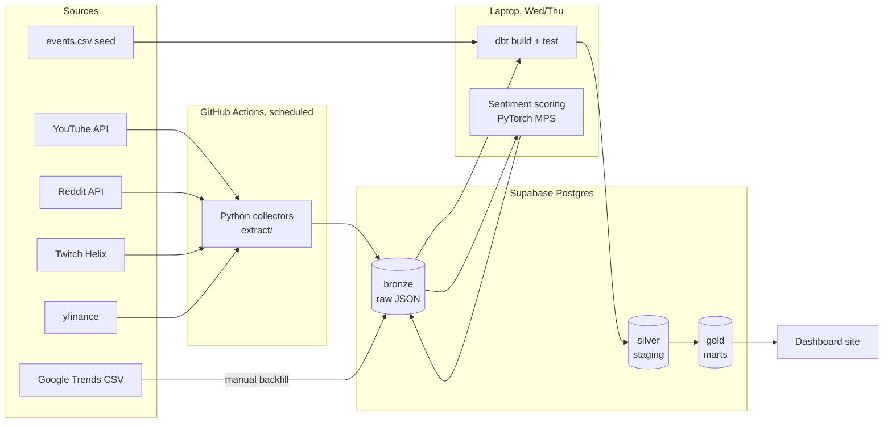

# Design doc

Status: v1.0 · Owner: Rex · Last updated: 29 Oct 2026

What we're building and why is in the [one-pager](one-pager.md). This doc covers how. Individual decisions are recorded as ADRs in [adr/](adr/).

## Architecture



Two things drive the shape of this:

1. Collection has to run while I'm not working on the project, five days a week. So collectors run on GitHub Actions and write straight to a hosted database (ADR-002).
2. Everything after collection only needs to run when I'm working on it. dbt and sentiment scoring run on my laptop, and move into Airflow in W11 (OPS-9).

## Collectors

Each source gets one module in `extract/`, with a `run()` that fetches and loads. They share one loader that writes to bronze.

| Collector | Schedule (UTC) | Notes |
|---|---|---|
| YouTube | Daily 00:15 | Tracked video IDs live in a config file |
| Twitch | Every 30 min | Category viewers and stream count; starts by 5 Nov for a baseline |
| Reddit | Daily 01:00 | Spoiler filter and username hashing at ingestion |
| Stocks | Weekdays 22:30 | After US close. Tokyo prices for the same date are already final |
| Google Trends | One-off backfill, then weekly | Daily series built from overlapping windows (method in ING-6) |

Scheduled Actions can start late or occasionally skip a run when GitHub is busy. Every row stores the real collection time, and analysis never assumes runs were evenly spaced.

The repo is public, so Actions minutes are free.

## Bronze schema

Every source writes to the same shape. Bronze is append only. Nothing in it is updated or deleted, except deletions required by a source's terms.

```sql
create schema bronze;

create table bronze.raw_payload (
    id          bigint generated always as identity primary key,
    source      text        not null,  -- 'youtube', 'twitch', ...
    endpoint    text        not null,  -- e.g. 'videos.list'
    run_id      text        not null,  -- GitHub Actions run ID, or 'local-<timestamp>'
    fetched_at  timestamptz not null,  -- when the API call was made
    loaded_at   timestamptz not null default now(),
    payload     jsonb       not null
);

create index on bronze.raw_payload (source, fetched_at);
```

One table with a `source` column is simpler than one table per source while we're still learning what the payloads look like. dbt staging models split it by source.

Usernames are hashed and spoiler posts are dropped before the payload is written, so bronze never holds data we've decided not to keep.

## Warehouse (dbt)

Bronze is raw, silver is cleaned and typed (dbt staging), and gold is facts and dimensions (dbt marts). Model names follow the dbt Labs style guide. The model list is in [backlog.md](backlog.md) under W3 to W5.

Two pieces of logic need care:

- **Event day mapping.** Each event in `events.csv` has an announcement time in US Eastern time. If it's before 16:00 on a trading day, the event day is that day. Otherwise it's the next trading day. For Tokyo-listed 6758.T, any US announcement maps to the next Tokyo session.
- **Estimation windows.** The market model for each event uses 120 trading days ending 10 days before the event, minus any days that fall within another event's window.

## Sentiment scoring

A batch job in `ml/` runs on my laptop using the M4's GPU through PyTorch MPS. It reads unscored comments from bronze, scores them with `cardiffnlp/twitter-roberta-base-sentiment-latest`, and writes scores back to a bronze table. dbt builds the daily aggregates from there. VADER runs alongside as a baseline for the evaluation (ML-3).

## Monitoring

- GitHub emails me when a workflow fails.
- Collectors fail on purpose (non-zero exit) if a response is empty or not a 200, so that silent gaps become visible failures.
- A daily health check counts rows per source per day and fails if any source is missing (OPS-6).
- Incidents get a short write-up in `docs/incidents/`.

## Testing

- Unit tests for parsing, hashing, spoiler filtering and event day mapping, using saved sample payloads. Tests never call real APIs.
- dbt tests on keys, relationships and accepted values, plus source freshness.
- CI runs lint and tests on every PR.

## Alternatives considered

| Option | Why not |
|---|---|
| Local Postgres in Docker as the main database | GitHub Actions can't reach it, and the laptop isn't on all week. Still used for dbt development. |
| Cron on the laptop | Misses runs whenever the laptop sleeps |
| Airflow from day one | Needs an always-on server to schedule collectors. Added later for the batch side only (OPS-9). |
| One bronze table per source | More migrations while payloads are still changing. Can be split later if needed. |

## Open questions

- Which dashboard tool to use (ADR-004, proposed).
- Whether YouTube's terms allow keeping a long daily history of view counts (see [data governance](data-governance.md)).
